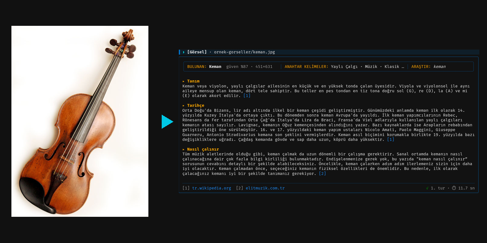

# Object Recognition and Web Lookup

[Türkçe](README.tr.md)

Recognizes the main object in an image given as a URL or a local file, picks
keywords that fit the object, searches the web and presents what it finds as
titled blocks with sources. Every turn is written to a record file, and the
chat context is kept for the whole session.

The interface and the collected information are in Turkish.



Violin photo: "Old violin.jpg", Frinck51, CC BY-SA 3.0, Wikimedia Commons.

## Installation

Requires Python 3.10 or later. The application runs entirely on the CPU.

```bash
python3 -m venv .venv
source .venv/bin/activate
pip install -r requirements.txt
```

The requirements file points to the CPU build of torch, so the install stays
around two hundred megabytes and the GPU build is not downloaded.

If the first command fails with "ensurepip is not available", the system is
missing the venv package. Either install python3-venv or use virtualenv.

```bash
pip install --user virtualenv
virtualenv .venv
```

The vision model weights are downloaded once on the first run, then the
vocabulary is encoded and cached in the models folder. The first start takes a
few minutes depending on the connection, later starts take a few seconds.
Library warnings are written to app.log.

## Usage

```bash
python3 main.py
```

Enter an image URL or a file path. Dragging the file into the terminal also
works. If a question is written next to the image, the search for that turn is
built from the question. Plain text written after an image analysis starts a
new search about the same object. Type q or press ctrl+c to quit.

The ornek-gorseller folder has freely licensed images to try. Give the file
path or drag the file into the window. Sources and licenses of the images are
in gorsel-kaynaklari.md in the same folder. ornek-kayit.json is the record of
a session run with these images.

The debug option shows the decisions of each step, the plain option replaces
the terminal interface with plain line output.

```bash
python3 main.py --debug
python3 main.py --plain
```

## How it works

1. The image is loaded, validated and prepared for the model.
2. The vision model encodes the image, compares it with 1200 object names and
   picks the closest name as the object. A classifier I trained gives a second
   opinion and takes over when the zero-shot result is not confident. The same
   vector is compared with 484 theme concepts, and the Turkish terms of the
   strongest themes become the keywords.
3. A rule-based Turkish search sentence is built from the object name, the
   keywords tagged with their roles and the context of the previous turn.
4. Information blocks are planned based on the object's family. Each block
   runs its own query. Recipe blocks extract ingredient and step lists from
   the page structure, variety blocks extract subheading lists. Other blocks
   are filled from a Wikipedia section or a paragraph selected with tf-idf.
5. The blocks are shown as one text with headings and numbered sources and
   are written to the record file. The session remembers the sources it has
   shown.

## Files

- main.py, input parsing and turn flow
- app/image_loader.py, image loading and validation
- app/vision.py, object and theme extraction with the vision model
- app/intent.py, Turkish search intent from keywords
- app/blocks.py, planning information blocks by object family
- app/structure.py, extracting lists, steps and subheadings from page structure
- app/search.py, Wikipedia and search engine queries
- app/extractor.py, page download and paragraph selection
- app/session.py, chat context and memory
- app/storage.py, record file
- app/ui.py, terminal interface
- app/render.py, converting blocks to markdown text
- data folder, object names, theme map, word roles and block schema
- training folder, classifier training
- tests folder, unit tests
- ornek-gorseller folder, sample images and their sources
- ornek-kayit.json, record file produced with the sample images

To retrain the classifier, extract the features first, then run the training.
The dataset is downloaded on the first run.

```bash
python3 training/prepare_features.py
python3 training/train_probe.py
python3 training/sweep.py
```

The third command is optional. It prints a sweep table for learning rate and
weight decay.

Run the tests with this command.

```bash
python3 -m unittest discover -s tests -t .
```

The application runs on Linux, macOS and Windows. On Windows, use python
instead of python3, and activate the virtual environment with
.venv\Scripts\activate. On Windows, use the Windows Terminal app instead of
the old command prompt for the interface to display correctly. Plain mode
works in both.

The reasons behind the model choice and the technical details are in
technical-report.md. The Turkish version is teknik-rapor.md.
